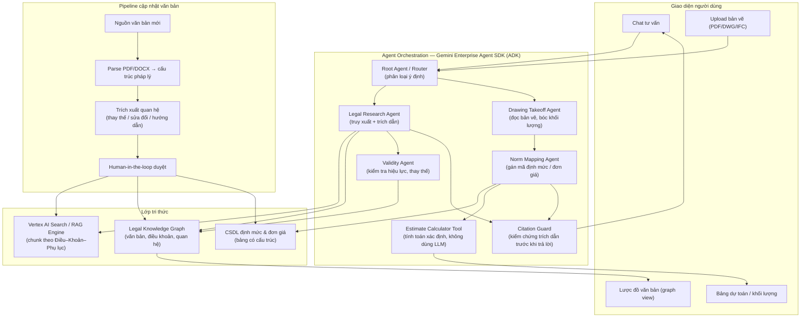
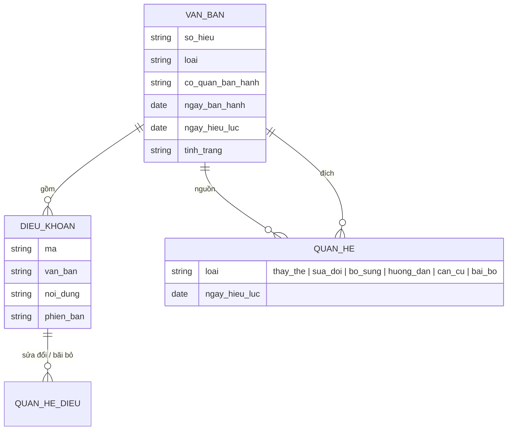

# Dự án #1 — AI Copilot Dự toán Xây dựng

> **Nền tảng agent:** Gemini Enterprise Agent SDK (Google Agent Development Kit – ADK, triển khai trên Vertex AI Agent Engine)
> **Số nhóm:** 1 nhóm (2 sinh viên)
> **Loại đề tài:** Luận văn tốt nghiệp — Hệ thống đa tác nhân (multi-agent) có kiểm soát ràng buộc pháp lý

---

## 1. Bối cảnh & vấn đề

Lập dự toán xây dựng ở Việt Nam đòi hỏi kỹ sư phải:

- Đọc bản vẽ thiết kế, bóc tách khối lượng công việc.
- Áp đúng **mã định mức**, **đơn giá**, **phương pháp xác định chi phí** theo hệ thống văn bản quy phạm pháp luật đang có hiệu lực.
- Theo dõi việc văn bản mới **thay thế / sửa đổi / bổ sung** văn bản cũ — một nguồn sai sót rất phổ biến.

Các chatbot LLM thông thường hay "bịa" số hiệu điều khoản, trích dẫn văn bản đã hết hiệu lực, hoặc không giải thích được vì sao chọn một định mức. Dự án này xây dựng một **AI Copilot** vừa hỗ trợ lập dự toán từ bản vẽ, vừa tư vấn kiến thức qua chat, với nguyên tắc cốt lõi:

> **Mọi câu trả lời đều phải có trích dẫn cụ thể đến văn bản pháp luật (số hiệu – điều – khoản – điểm/phụ lục), và đi kèm Lược đồ văn bản cho biết văn bản đó nằm ở đâu trong chuỗi văn bản ban hành trước / sau.**

---

## 2. Mục tiêu dự án

| # | Mục tiêu | Tiêu chí đo lường (gợi ý) |
|---|----------|---------------------------|
| G1 | Xây dựng kho tri thức pháp luật dự toán có cấu trúc (điều/khoản/phụ lục/bảng định mức) | 100% văn bản trong phạm vi được số hoá, chia đoạn theo cấu trúc pháp lý |
| G2 | Chat tư vấn kiến thức dự toán có trích dẫn chính xác | ≥ 90% câu trả lời có trích dẫn đúng trên bộ câu hỏi kiểm thử; 0 trích dẫn "bịa" |
| G3 | Lược đồ văn bản (văn bản trước / sau / thay thế / sửa đổi / hướng dẫn) | Hiển thị được đồ thị quan hệ cho mọi văn bản được trích dẫn |
| G4 | Cập nhật văn bản pháp luật mới mà không phải huấn luyện lại mô hình | Thêm 1 văn bản mới → tự động cập nhật kho tri thức + lược đồ trong < 30 phút |
| G5 | Hỗ trợ lập dự toán từ bản vẽ thiết kế | Bóc tách khối lượng + gợi ý mã định mức cho ít nhất 1 loại hạng mục (VD: kết cấu BTCT) |
| G6 | Kiểm soát hiệu lực văn bản | Cảnh báo khi người dùng hỏi/áp dụng nội dung đã hết hiệu lực hoặc bị sửa đổi |

---

## 3. Phạm vi văn bản pháp luật (corpus ban đầu)

| Số hiệu | Loại | Ghi chú cho nhóm |
|---------|------|------------------|
| Nghị định 206/2026/NĐ-CP | Nghị định | Văn bản cấp cao nhất trong corpus — xác định quan hệ với các Thông tư bên dưới |
| Thông tư 38/2026/TT-BXD | Thông tư | Văn bản mới — xác định văn bản bị thay thế / sửa đổi |
| Thông tư 37/2026/TT-BXD | Thông tư | Văn bản mới — xác định văn bản bị thay thế / sửa đổi |
| Thông tư 36/2026/TT-BXD | Thông tư | Văn bản mới — xác định văn bản bị thay thế / sửa đổi |
| Thông tư 12/2021/TT-BXD | Thông tư | Ban hành định mức xây dựng |
| Thông tư 09/2024/TT-BXD | Thông tư | Sửa đổi, bổ sung định mức của TT 12/2021/TT-BXD |
| Thông tư 12/2019/TT-BXD | Thông tư | Văn bản cũ — xác định tình trạng hiệu lực hiện nay |

> ⚠️ **Yêu cầu bắt buộc:** Nhóm phải **tự xác minh** nội dung, ngày hiệu lực, tình trạng hiệu lực và quan hệ giữa các văn bản từ nguồn chính thống (Công báo, Cơ sở dữ liệu quốc gia về VBQPPL, Cổng thông tin Bộ Xây dựng). Bảng trên chỉ là điểm xuất phát; việc **xác lập đúng quan hệ văn bản chính là một phần kết quả của luận văn**.

---

## 4. Kiến trúc tổng thể



### 4.1. Nguyên tắc thiết kế

1. **Grounding bắt buộc:** Agent chỉ được trả lời dựa trên đoạn văn bản truy xuất được. Không có nguồn → trả lời "không tìm thấy căn cứ" thay vì suy đoán.
2. **Tách LLM khỏi tính toán:** Mọi phép tính khối lượng, chi phí do tool xác định (Python function) thực hiện; LLM chỉ chọn tham số và giải thích.
3. **Citation Guard:** Trước khi trả lời, mỗi trích dẫn được đối chiếu lại với kho tri thức (số hiệu, điều, khoản có tồn tại và nội dung khớp).
4. **Hiệu lực theo thời điểm:** Mỗi câu hỏi có thể kèm "thời điểm áp dụng"; hệ thống chọn phiên bản văn bản có hiệu lực tại thời điểm đó.
5. **Cập nhật không cần fine-tune:** Văn bản mới được nạp qua pipeline ingest; mô hình không cần huấn luyện lại.

### 4.2. Định dạng câu trả lời chuẩn

```text
[Trả lời]
Chi phí dự phòng cho yếu tố khối lượng phát sinh được xác định ...

[Căn cứ pháp lý]
1. <Số hiệu văn bản>, Điều X, Khoản Y, Điểm z — "trích nguyên văn ngắn..."
2. <Số hiệu văn bản>, Phụ lục ..., Bảng ...

[Tình trạng hiệu lực]
- <Văn bản A>: còn hiệu lực (từ dd/mm/yyyy)
- <Văn bản B>: đã được sửa đổi một phần bởi <Văn bản C> — nội dung trên đã áp dụng bản sửa đổi.

[Lược đồ văn bản]  → (render dạng graph trên UI)
```

### 4.3. Lược đồ văn bản (Legal Document Graph)

Mô hình dữ liệu tối thiểu:



Trên UI, khi một câu trả lời trích dẫn văn bản X, lược đồ hiển thị:
- **Văn bản ban hành trước** liên quan (X thay thế / sửa đổi / hướng dẫn văn bản nào).
- **Văn bản ban hành sau** liên quan (văn bản nào thay thế / sửa đổi X).
- **Văn bản căn cứ** (Nghị định là căn cứ của Thông tư…).
- Màu sắc theo tình trạng: còn hiệu lực / hết hiệu lực một phần / hết hiệu lực.

---

## 5. Mô tả chi tiết các thành phần

> Dự án #1 do **một nhóm** đảm nhận. Các thành phần dưới đây là **gói công việc** để hai thành viên chia việc, không phải module độc lập cho nhóm khác.

### Thành phần A — Legal Knowledge Base & Pipeline cập nhật

**Mục tiêu:** Biến văn bản pháp luật thô thành tri thức có cấu trúc, truy xuất chính xác và có thể cập nhật liên tục.

| Hạng mục | Yêu cầu |
|----------|---------|
| Parse văn bản | Tách Chương → Mục → Điều → Khoản → Điểm; tách Phụ lục, bảng định mức thành dữ liệu bảng |
| Chunking | Theo đơn vị pháp lý (Điều/Khoản), giữ metadata: số hiệu, điều, khoản, ngày hiệu lực |
| Knowledge Graph | Node: văn bản, điều khoản; Edge: thay thế, sửa đổi, bổ sung, hướng dẫn, căn cứ, bãi bỏ |
| Trích xuất quan hệ | Agent đọc phần "Căn cứ", "Điều khoản thi hành", "Hiệu lực thi hành" để đề xuất quan hệ |
| Human-in-the-loop | Quan hệ do AI đề xuất phải được người duyệt trước khi ghi vào graph |
| Cập nhật | Thêm văn bản mới → tự động cập nhật index RAG + graph + cảnh báo các câu trả lời bị ảnh hưởng |

**Đầu ra:** Bộ dữ liệu đã số hoá 7 văn bản, graph quan hệ, API truy vấn `get_article()`, `get_relations()`, `get_valid_version(date)`.

### Thành phần B — Legal Chat Copilot (multi-agent)

**Mục tiêu:** Trả lời câu hỏi về dự toán xây dựng, luôn có trích dẫn và lược đồ văn bản.

| Agent | Nhiệm vụ |
|-------|----------|
| Root / Router Agent | Phân loại câu hỏi: tra cứu pháp lý, hỏi cách tính, hỏi định mức, yêu cầu dự toán từ bản vẽ |
| Legal Research Agent | Truy xuất (hybrid search: keyword theo số hiệu + semantic), tổng hợp câu trả lời |
| Validity Agent | Kiểm tra hiệu lực tại thời điểm áp dụng, thay thế bằng nội dung sửa đổi nếu có |
| Citation Guard | Kiểm chứng từng trích dẫn; loại bỏ hoặc gắn cờ trích dẫn không khớp |

**Đầu ra:** Giao diện chat, bộ ≥ 100 câu hỏi kiểm thử có đáp án chuẩn, báo cáo đánh giá (độ chính xác trích dẫn, tỉ lệ hallucination, độ trễ).

### Thành phần C — Drawing Takeoff & Estimate

**Mục tiêu:** Từ bản vẽ thiết kế, hỗ trợ bóc tách khối lượng và lập bảng dự toán sơ bộ.

| Hạng mục | Yêu cầu |
|----------|---------|
| Input | PDF bản vẽ (bắt buộc); DWG/IFC (khuyến khích) |
| Bóc tách | Dùng Gemini multimodal đọc bản vẽ + bảng thống kê; giới hạn ở 1–2 loại hạng mục để đảm bảo chất lượng |
| Gán định mức | Norm Mapping Agent đề xuất mã định mức kèm căn cứ (thông tư, phụ lục, mã hiệu) |
| Tính toán | Tool tính toán xác định (không dùng LLM) ra bảng khối lượng × định mức × đơn giá |
| Giải thích | Mỗi dòng dự toán có nút "Vì sao?" → trả lời có trích dẫn như Thành phần B |
| Kiểm soát | Người dùng xác nhận/chỉnh sửa khối lượng trước khi tính chi phí (human-in-the-loop) |

**Đầu ra:** Bảng dự toán xuất Excel, có cột "Căn cứ pháp lý" cho từng dòng.

### Gợi ý phân công 2 thành viên

| Thành viên | Phụ trách chính | Phối hợp |
|------------|-----------------|----------|
| SV1 | Thành phần A (Knowledge Base, Graph, pipeline cập nhật) + Validity Agent | Định nghĩa API tri thức cho SV2 |
| SV2 | Thành phần B (Chat, Router, Citation Guard) + Thành phần C (bản vẽ, dự toán) | Bộ câu hỏi kiểm thử chung |

---

## 6. Công nghệ đề xuất

| Lớp | Công nghệ |
|-----|-----------|
| Agent framework | Gemini Enterprise Agent SDK / Google ADK (Python), multi-agent (`LlmAgent`, `SequentialAgent`, tools) |
| Mô hình | Gemini (bản Pro cho suy luận pháp lý, bản Flash cho router/tác vụ nhẹ) |
| Triển khai agent | Vertex AI Agent Engine |
| Truy xuất | Vertex AI Search hoặc Vertex AI RAG Engine (hybrid search) |
| Knowledge Graph | Neo4j / Spanner Graph / PostgreSQL + bảng quan hệ |
| CSDL định mức | PostgreSQL / BigQuery |
| Frontend | Next.js hoặc Streamlit; graph view bằng Cytoscape.js / React Flow |
| Đánh giá | ADK evaluation, bộ test tự xây dựng (golden Q&A) |

---

## 7. Lộ trình gợi ý (16 tuần)

| Giai đoạn | Tuần | Kết quả |
|-----------|------|---------|
| Nghiên cứu | 1–2 | Tổng quan ADK, nghiên cứu nghiệp vụ dự toán, xác minh corpus văn bản |
| Knowledge Base | 3–6 | Parse 7 văn bản, graph quan hệ, API truy vấn |
| Chat Copilot | 5–9 | Multi-agent chat có trích dẫn + lược đồ văn bản |
| Bản vẽ & dự toán | 9–12 | Bóc tách khối lượng 1–2 hạng mục, bảng dự toán có căn cứ |
| Cập nhật văn bản | 12–13 | Demo thêm văn bản mới end-to-end |
| Đánh giá & luận văn | 14–16 | Báo cáo đánh giá, viết luận văn, demo |

---

## 8. Sản phẩm bàn giao

- [ ] Mã nguồn (repo GitHub) + hướng dẫn cài đặt
- [ ] Bộ dữ liệu văn bản đã số hoá + graph quan hệ (đã được xác minh)
- [ ] Bộ câu hỏi kiểm thử (≥ 100 câu) và kết quả đánh giá
- [ ] Demo: (1) chat có trích dẫn + lược đồ, (2) thêm văn bản mới, (3) dự toán từ bản vẽ
- [ ] Luận văn + slide bảo vệ

## 9. Rủi ro & lưu ý

- **Sai lệch pháp lý:** Copilot chỉ là công cụ hỗ trợ; UI phải ghi rõ kết quả cần kỹ sư có chuyên môn kiểm tra.
- **Chất lượng OCR bản vẽ:** Giới hạn phạm vi hạng mục; ưu tiên bản vẽ có bảng thống kê.
- **Văn bản mới chưa có bản số đầy đủ:** Pipeline phải xử lý được văn bản scan (OCR) và ghi nhận độ tin cậy.
