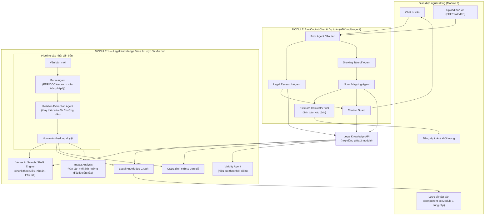
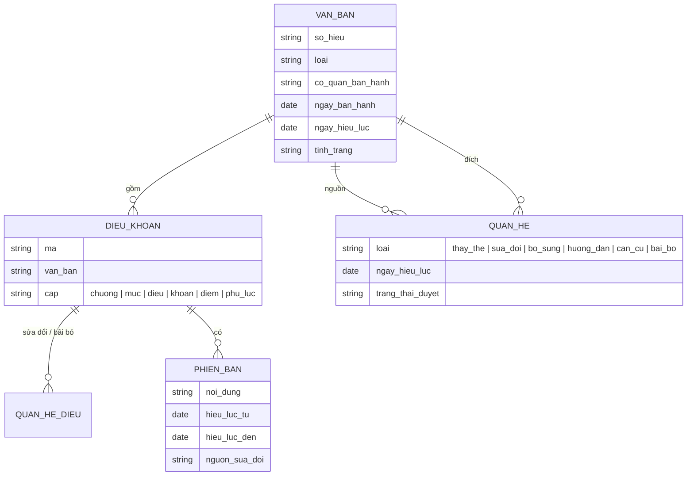

# Dự án #1 — AI Copilot Dự toán Xây dựng

> **Nền tảng agent:** Gemini Enterprise Agent SDK (Google Agent Development Kit – ADK, triển khai trên Vertex AI Agent Engine)
> **Số nhóm:** 2 nhóm (mỗi nhóm 2 sinh viên) — mỗi nhóm nhận 1 module
> **Loại đề tài:** Luận văn tốt nghiệp — Hệ thống đa tác nhân (multi-agent) có kiểm soát ràng buộc pháp lý

---

## 1. Bối cảnh & vấn đề

Lập dự toán xây dựng ở Việt Nam đòi hỏi kỹ sư phải:

- Đọc bản vẽ thiết kế, bóc tách khối lượng công việc.
- Áp đúng **mã định mức**, **đơn giá**, **phương pháp xác định chi phí** theo hệ thống văn bản quy phạm pháp luật đang có hiệu lực.
- Theo dõi việc văn bản mới **thay thế / sửa đổi / bổ sung** văn bản cũ — một nguồn sai sót rất phổ biến.

Các chatbot LLM thông thường hay "bịa" số hiệu điều khoản, trích dẫn văn bản đã hết hiệu lực, hoặc không giải thích được vì sao chọn một định mức. Dự án này xây dựng một **AI Copilot** vừa tư vấn kiến thức dự toán qua chat, vừa hỗ trợ lập dự toán từ bản vẽ, với nguyên tắc cốt lõi:

> **Mọi câu trả lời đều phải có trích dẫn cụ thể đến văn bản pháp luật (số hiệu – điều – khoản – điểm/phụ lục), và đi kèm Lược đồ văn bản cho biết văn bản đó nằm ở đâu trong chuỗi văn bản ban hành trước / sau.**

Dự án được chia thành **2 module** cho 2 nhóm:

| Module | Tên | Vai trò |
|--------|-----|---------|
| **Module 1** | Legal Knowledge Base & Lược đồ văn bản | "Bộ não pháp lý": số hoá văn bản, đồ thị quan hệ, kiểm tra hiệu lực, cập nhật văn bản mới, API truy xuất |
| **Module 2** | Copilot Chat & Dự toán từ bản vẽ | "Người tư vấn": chat đa tác nhân có trích dẫn, kiểm chứng trích dẫn, bóc tách khối lượng và lập dự toán |

---

## 2. Mục tiêu dự án

| # | Mục tiêu | Module | Tiêu chí đo lường (gợi ý) |
|---|----------|--------|---------------------------|
| G1 | Kho tri thức pháp luật dự toán có cấu trúc (điều/khoản/phụ lục/bảng định mức) | 1 | 100% văn bản trong phạm vi được số hoá, chia đoạn theo cấu trúc pháp lý |
| G2 | Lược đồ văn bản (trước / sau / thay thế / sửa đổi / hướng dẫn / căn cứ) | 1 | Có đồ thị quan hệ cho mọi văn bản trong corpus, đã được người duyệt |
| G3 | Kiểm soát hiệu lực theo thời điểm | 1 | Trả đúng phiên bản điều khoản có hiệu lực tại một ngày cho trước |
| G4 | Cập nhật văn bản mới không cần huấn luyện lại mô hình | 1 | Thêm 1 văn bản mới → kho tri thức + lược đồ cập nhật trong < 30 phút |
| G5 | Chat tư vấn có trích dẫn chính xác | 2 | ≥ 90% câu trả lời trích dẫn đúng trên bộ câu hỏi kiểm thử; 0 trích dẫn "bịa" |
| G6 | Hỗ trợ lập dự toán từ bản vẽ | 2 | Bóc tách khối lượng + gợi ý mã định mức cho ít nhất 1 loại hạng mục (VD: kết cấu BTCT) |

---

## 3. Phạm vi văn bản pháp luật (corpus ban đầu)

| Số hiệu | Loại | Ghi chú cho nhóm |
|---------|------|------------------|
| Nghị định 206/2026/NĐ-CP | Nghị định | Văn bản cấp cao nhất trong corpus — xác định quan hệ với các Thông tư bên dưới |
| Thông tư 38/2026/TT-BXD | Thông tư | Văn bản mới — xác định văn bản bị thay thế / sửa đổi |
| Thông tư 37/2026/TT-BXD | Thông tư | Văn bản mới — xác định văn bản bị thay thế / sửa đổi |
| Thông tư 36/2026/TT-BXD | Thông tư | Văn bản mới — xác định văn bản bị thay thế / sửa đổi |
| Thông tư 12/2021/TT-BXD | Thông tư | Ban hành định mức xây dựng |
| Thông tư 09/2024/TT-BXD | Thông tư | Sửa đổi, bổ sung định mức của TT 12/2021/TT-BXD |
| Thông tư 12/2019/TT-BXD | Thông tư | Văn bản cũ — xác định tình trạng hiệu lực hiện nay |

> ⚠️ **Yêu cầu bắt buộc (Module 1 chịu trách nhiệm chính):** Nhóm phải **tự xác minh** nội dung, ngày hiệu lực, tình trạng hiệu lực và quan hệ giữa các văn bản từ nguồn chính thống (Công báo, Cơ sở dữ liệu quốc gia về VBQPPL, Cổng thông tin Bộ Xây dựng). Bảng trên chỉ là điểm xuất phát; việc **xác lập đúng quan hệ văn bản chính là một phần kết quả của luận văn**.

---

## 4. Kiến trúc tổng thể



### 4.1. Nguyên tắc thiết kế

1. **Grounding bắt buộc:** Agent chỉ được trả lời dựa trên đoạn văn bản truy xuất được. Không có nguồn → trả lời "không tìm thấy căn cứ" thay vì suy đoán.
2. **Tách LLM khỏi tính toán:** Mọi phép tính khối lượng, chi phí do tool xác định (Python function) thực hiện; LLM chỉ chọn tham số và giải thích.
3. **Citation Guard:** Trước khi trả lời, mỗi trích dẫn được đối chiếu lại với kho tri thức qua Legal Knowledge API.
4. **Hiệu lực theo thời điểm:** Mỗi câu hỏi có thể kèm "thời điểm áp dụng"; hệ thống chọn phiên bản văn bản có hiệu lực tại thời điểm đó.
5. **Cập nhật không cần fine-tune:** Văn bản mới được nạp qua pipeline ingest; mô hình không cần huấn luyện lại.
6. **Hai module giao tiếp qua API:** Module 2 không đọc trực tiếp DB của Module 1; mọi truy cập tri thức đều qua Legal Knowledge API.

### 4.2. Legal Knowledge API — hợp đồng giữa hai module

Hai nhóm cùng chốt API này trong **tuần 3**. Module 1 cung cấp **mock server + dữ liệu mẫu** (1–2 văn bản đã số hoá) trước **tuần 4** để Module 2 phát triển song song.

| Endpoint | Mô tả |
|----------|-------|
| `POST /search` | Tìm kiếm hybrid (số hiệu + ngữ nghĩa); tham số `query`, `as_of_date`, `top_k`; trả về đoạn văn bản + metadata đầy đủ |
| `GET /documents/{so_hieu}` | Thông tin văn bản: loại, cơ quan, ngày ban hành, ngày hiệu lực, tình trạng |
| `GET /articles/{so_hieu}/{dieu}/{khoan}?as_of_date=` | Nội dung điều/khoản **có hiệu lực** tại ngày cho trước (đã áp sửa đổi nếu có) |
| `POST /citations/verify` | Kiểm chứng một trích dẫn: có tồn tại không, nội dung trích có khớp không, còn hiệu lực không |
| `GET /graph/{so_hieu}?depth=` | Lược đồ văn bản: văn bản trước / sau / căn cứ / thay thế / sửa đổi |
| `GET /norms?ma_hieu=&keyword=` | Tra cứu định mức: mã hiệu, thành phần hao phí, đơn vị, căn cứ (thông tư, phụ lục) |
| Webhook `document.updated` | Báo khi có văn bản mới hoặc thay đổi hiệu lực, kèm danh sách điều khoản bị ảnh hưởng |

Ví dụ kết quả `POST /citations/verify`:

```json
{
  "citation": { "so_hieu": "<số hiệu>", "dieu": "X", "khoan": "Y", "quote": "..." },
  "exists": true,
  "quote_match": 0.96,
  "valid_as_of": "2026-10-29",
  "status": "amended",
  "amended_by": [{ "so_hieu": "<văn bản sửa đổi>", "dieu": "Z", "effective_date": "..." }],
  "current_text": "..."
}
```

### 4.3. Định dạng câu trả lời chuẩn (Module 2)

```text
[Trả lời]
Chi phí dự phòng cho yếu tố khối lượng phát sinh được xác định ...

[Căn cứ pháp lý]
1. <Số hiệu văn bản>, Điều X, Khoản Y, Điểm z — "trích nguyên văn ngắn..."
2. <Số hiệu văn bản>, Phụ lục ..., Bảng ...

[Tình trạng hiệu lực]
- <Văn bản A>: còn hiệu lực (từ dd/mm/yyyy)
- <Văn bản B>: đã được sửa đổi một phần bởi <Văn bản C> — nội dung trên đã áp dụng bản sửa đổi.

[Lược đồ văn bản]  → (render dạng graph trên UI)
```

---

## 5. MODULE 1 — Legal Knowledge Base & Lược đồ văn bản

### 5.1. Mục tiêu module

1. Biến văn bản pháp luật thô thành **tri thức có cấu trúc**, truy xuất chính xác đến cấp điều/khoản/điểm/phụ lục.
2. Xây dựng **Lược đồ văn bản** (Legal Knowledge Graph) thể hiện quan hệ giữa các văn bản và giữa các điều khoản.
3. Trả lời chính xác câu hỏi **"điều khoản này có hiệu lực tại ngày X không, nội dung lúc đó là gì?"**.
4. **Cập nhật văn bản mới** liên tục, có người duyệt, và chỉ ra điều khoản nào bị ảnh hưởng.
5. Cung cấp **Legal Knowledge API** ổn định cho Module 2.

### 5.2. Mô hình dữ liệu lược đồ văn bản



Trên UI (component do Module 1 cung cấp, Module 2 nhúng vào), khi một câu trả lời trích dẫn văn bản X, lược đồ hiển thị:
- **Văn bản ban hành trước** liên quan (X thay thế / sửa đổi / hướng dẫn văn bản nào).
- **Văn bản ban hành sau** liên quan (văn bản nào thay thế / sửa đổi X).
- **Văn bản căn cứ** (Nghị định là căn cứ của Thông tư…).
- Màu sắc theo tình trạng: còn hiệu lực / hết hiệu lực một phần / hết hiệu lực.

### 5.3. Các agent & chức năng

| Agent / thành phần | Nhiệm vụ | Mức độ |
|--------------------|----------|--------|
| Parse Agent | Tách Chương → Mục → Điều → Khoản → Điểm; tách Phụ lục, bảng định mức thành dữ liệu bảng; xử lý cả văn bản scan (OCR) và ghi độ tin cậy | Bắt buộc |
| Chunking & Indexing | Chunk theo đơn vị pháp lý, giữ metadata (số hiệu, điều, khoản, ngày hiệu lực); index vào Vertex AI Search / RAG Engine | Bắt buộc |
| Relation Extraction Agent | Đọc phần "Căn cứ", "Điều khoản thi hành", "Hiệu lực thi hành", các câu "sửa đổi, bổ sung…" để **đề xuất** quan hệ văn bản và quan hệ điều khoản | Bắt buộc |
| Human-in-the-loop | Màn hình duyệt quan hệ do AI đề xuất trước khi ghi vào graph | Bắt buộc |
| Validity Agent | Dựng phiên bản điều khoản theo thời gian; trả nội dung có hiệu lực tại một ngày | Bắt buộc |
| Impact Analysis | Khi có văn bản mới: liệt kê điều khoản, định mức bị ảnh hưởng; phát webhook `document.updated` | Bắt buộc |
| Norm Database | Bảng định mức có cấu trúc: mã hiệu, tên công tác, thành phần hao phí (vật liệu, nhân công, máy), đơn vị, căn cứ | Bắt buộc |
| Legal Knowledge API | Các endpoint ở mục 4.2 + OpenAPI spec + mock server | Bắt buộc |
| Graph View component | Component hiển thị lược đồ (Cytoscape.js / React Flow) để Module 2 nhúng | Bắt buộc |
| Theo dõi nguồn văn bản mới | Định kỳ kiểm tra nguồn chính thống, báo khi có văn bản mới liên quan | Khuyến khích |

### 5.4. Sản phẩm bàn giao

- [ ] Bộ dữ liệu 7 văn bản đã số hoá theo cấu trúc pháp lý, kèm bảng định mức có cấu trúc
- [ ] Legal Knowledge Graph **đã được xác minh** (có bảng đối chiếu nguồn chính thống cho từng quan hệ)
- [ ] Validity Agent: truy vấn nội dung theo thời điểm
- [ ] Pipeline cập nhật: demo thêm một văn bản mới end-to-end (parse → đề xuất quan hệ → duyệt → cập nhật → impact analysis)
- [ ] Legal Knowledge API + OpenAPI spec + **mock server giao cho Module 2 trước tuần 4**
- [ ] Graph View component
- [ ] Báo cáo đánh giá: độ chính xác parse cấu trúc, precision/recall trích xuất quan hệ, **recall@k của truy xuất** trên bộ câu hỏi chung, độ chính xác truy vấn hiệu lực theo thời điểm, thời gian cập nhật một văn bản

### 5.5. Gợi ý phân công

| Thành viên | Phụ trách |
|------------|-----------|
| SV1 | Parse Agent, chunking & indexing, Norm Database, pipeline cập nhật, màn hình duyệt |
| SV2 | Relation Extraction Agent, Knowledge Graph, Validity Agent, Impact Analysis, Legal Knowledge API, Graph View component |

---

## 6. MODULE 2 — Copilot Chat & Dự toán từ bản vẽ

### 6.1. Mục tiêu module

1. Trả lời câu hỏi về dự toán xây dựng qua chat, **luôn có trích dẫn đã được kiểm chứng** và lược đồ văn bản.
2. Từ bản vẽ thiết kế, hỗ trợ **bóc tách khối lượng** và **lập bảng dự toán sơ bộ**, mỗi dòng có căn cứ pháp lý.
3. Giữ người dùng (kỹ sư) trong vòng kiểm soát ở các bước quan trọng.

### 6.2. Các agent

| Agent / thành phần | Nhiệm vụ |
|--------------------|----------|
| Root / Router Agent | Phân loại câu hỏi: tra cứu pháp lý, hỏi cách tính, hỏi định mức, yêu cầu dự toán từ bản vẽ |
| Legal Research Agent | Gọi `POST /search` (theo `as_of_date`), đọc điều khoản liên quan, tổng hợp câu trả lời theo định dạng chuẩn (mục 4.3) |
| Citation Guard | Gọi `POST /citations/verify` cho **từng** trích dẫn; loại bỏ hoặc gắn cờ trích dẫn không khớp / hết hiệu lực trước khi trả lời |
| Drawing Takeoff Agent | Dùng Gemini multimodal đọc bản vẽ + bảng thống kê; bóc tách khối lượng cho 1–2 loại hạng mục |
| Norm Mapping Agent | Gọi `GET /norms` để đề xuất mã định mức kèm căn cứ (thông tư, phụ lục, mã hiệu) |
| Estimate Calculator Tool | Tool tính toán xác định (không dùng LLM): khối lượng × định mức × đơn giá |
| Explain ("Vì sao?") | Mỗi dòng dự toán có nút giải thích → trả lời có trích dẫn như chat |

### 6.3. Chức năng chi tiết

| Hạng mục | Yêu cầu | Mức độ |
|----------|---------|--------|
| Chat | Hội thoại nhiều lượt, nhớ ngữ cảnh dự án, hỗ trợ "thời điểm áp dụng" | Bắt buộc |
| Trích dẫn | 100% trích dẫn đi qua Citation Guard; câu trả lời không có căn cứ → nói rõ "không tìm thấy căn cứ" | Bắt buộc |
| Lược đồ văn bản | Nhúng Graph View component của Module 1 cho mọi văn bản được trích dẫn | Bắt buộc |
| Input bản vẽ | PDF bản vẽ (bắt buộc); DWG/IFC (khuyến khích) | Bắt buộc |
| Bóc tách | Giới hạn 1–2 loại hạng mục để đảm bảo chất lượng | Bắt buộc |
| Human-in-the-loop | Người dùng xác nhận/chỉnh sửa khối lượng trước khi tính chi phí | Bắt buộc |
| Xuất dự toán | Excel, có cột "Căn cứ pháp lý" cho từng dòng | Bắt buộc |
| Cảnh báo hiệu lực | Khi nhận `document.updated`, gắn cờ các câu trả lời / dự toán đã lưu bị ảnh hưởng | Khuyến khích |

### 6.4. Sản phẩm bàn giao

- [ ] Giao diện chat + upload bản vẽ + bảng dự toán + lược đồ văn bản
- [ ] Multi-agent ADK: Router, Legal Research, Citation Guard, Drawing Takeoff, Norm Mapping
- [ ] Estimate Calculator Tool + xuất Excel có cột căn cứ pháp lý
- [ ] Bộ ≥ 100 câu hỏi kiểm thử có đáp án chuẩn (**xây dựng cùng Module 1**)
- [ ] Bộ bản vẽ kiểm thử có khối lượng chuẩn (do người có chuyên môn bóc tay)
- [ ] Báo cáo đánh giá: độ chính xác trích dẫn, tỉ lệ hallucination (trước/sau Citation Guard), sai số khối lượng so với bóc tay, độ trễ

### 6.5. Gợi ý phân công

| Thành viên | Phụ trách |
|------------|-----------|
| SV1 | Router, Legal Research Agent, Citation Guard, giao diện chat, đánh giá chat |
| SV2 | Drawing Takeoff Agent, Norm Mapping Agent, Estimate Calculator, bảng dự toán & xuất Excel, đánh giá bóc tách |

### 6.6. Phát triển song song với Module 1

Từ tuần 4, Module 2 làm việc với **mock server** của Legal Knowledge API; chuyển sang API thật từ tuần 8.

---

## 7. Công nghệ đề xuất

| Lớp | Công nghệ |
|-----|-----------|
| Agent framework | Gemini Enterprise Agent SDK / Google ADK (Python), multi-agent (`LlmAgent`, `SequentialAgent`, tools) |
| Mô hình | Gemini (bản Pro cho suy luận pháp lý, bản Flash cho router/tác vụ nhẹ) |
| Triển khai agent | Vertex AI Agent Engine |
| Truy xuất | Vertex AI Search hoặc Vertex AI RAG Engine (hybrid search) |
| Knowledge Graph | Neo4j / Spanner Graph / PostgreSQL + bảng quan hệ |
| CSDL định mức | PostgreSQL / BigQuery |
| API | FastAPI, OpenAPI, mock server (Prism / tương đương) |
| Frontend | Next.js hoặc Streamlit; graph view bằng Cytoscape.js / React Flow |
| Đánh giá | ADK evaluation, bộ test tự xây dựng (golden Q&A) |

---

## 8. Lộ trình gợi ý (16 tuần)

| Tuần | Module 1 (Knowledge Base & Lược đồ) | Module 2 (Copilot Chat & Dự toán) |
|------|-------------------------------------|-----------------------------------|
| 1–2 | Nghiên cứu ADK, xác minh corpus văn bản từ nguồn chính thống | Nghiên cứu ADK, nghiệp vụ dự toán, thu thập bản vẽ mẫu |
| 3 | **Chốt Legal Knowledge API với Module 2**; bắt đầu bộ câu hỏi kiểm thử chung | **Chốt Legal Knowledge API**; bắt đầu bộ câu hỏi kiểm thử chung |
| 4 | Giao mock server + 1–2 văn bản mẫu | Router + Legal Research Agent trên mock server |
| 4–7 | Parse 7 văn bản, indexing, Norm Database | Citation Guard, giao diện chat |
| 7–10 | Relation Extraction, Knowledge Graph, màn hình duyệt, Validity Agent | Chuyển sang API thật (tuần 8); Drawing Takeoff Agent |
| 10–12 | Pipeline cập nhật + Impact Analysis, Graph View component | Norm Mapping, Estimate Calculator, xuất Excel, nhúng Graph View |
| 13 | Demo thêm văn bản mới end-to-end | Cảnh báo hiệu lực, tích hợp end-to-end |
| 14 | Đánh giá truy xuất, quan hệ, hiệu lực | Đánh giá chat, bóc tách |
| 15–16 | Luận văn + demo | Luận văn + demo |

---

## 9. Rủi ro & lưu ý

- **Sai lệch pháp lý:** Copilot chỉ là công cụ hỗ trợ; UI phải ghi rõ kết quả cần kỹ sư có chuyên môn kiểm tra.
- **Quan hệ văn bản sai:** AI chỉ được **đề xuất**; quan hệ chỉ vào graph sau khi người duyệt và có nguồn đối chiếu.
- **Phụ thuộc giữa hai nhóm:** Module 2 phụ thuộc Legal Knowledge API — chốt API sớm, giao mock server trước tuần 4, dùng versioning.
- **Chất lượng OCR bản vẽ:** giới hạn phạm vi hạng mục; ưu tiên bản vẽ có bảng thống kê.
- **Văn bản mới chưa có bản số đầy đủ:** pipeline phải xử lý được văn bản scan (OCR) và ghi nhận độ tin cậy.
